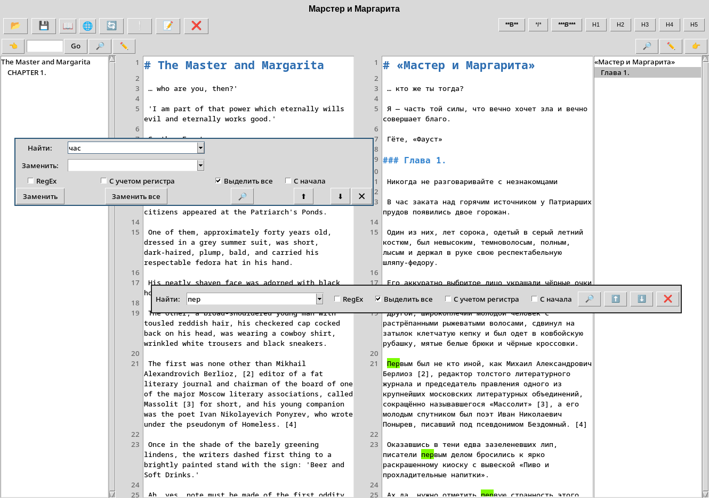

# Paraline

**Параллельный редактор для файлов Markdown (`*.en.md` и `*.ru.md`)**



Данное приложение представляет собой специализированный редактор для параллельной работы над документами,
в частности, Markdown-файлами, предназначенный для перевода или локализации.
Оно позволяет пользователю работать над исходной и целевой версиями текста параллельно,
обеспечивая целостность и согласованность двух текстов.

## Требования

Для работы приложения необходимы следующие компоненты:

*   Python 3.11 или новее
*   pip (менеджер пакетов Python)
*   Библиотеки `EbookLib` и `reportlab`

## Установка и запуск

Следуйте этим шагам для установки и запуска Paraline:

1.  **Создание виртуального окружения (venv):**
    ```bash
    python -m venv .venv
    ```

2.  **Активация виртуального окружения**
    *   **macOS / Linux:**
        ```bash
        source .venv/bin/activate
        ```
    *   **Windows:**
        ```bash
        .venv\Scripts\activate
        ```

3.  **Установка зависимостей**
    Установите все необходимые библиотеки, указанные в файле `requirements.txt`:
    ```bash
    pip install -r requirements.txt
    ```

4.  **Запуск приложения**
    Запустите редактор, выполнив следующую команду:
    ```bash
    python main.py
    ```

## 📚 Основные Возможности

### Параллельное Редактирование (Side-by-Side Editing)
Редактор отображает две области текста — одну для оригинального документа и одну для перевода,
позволяя пользователю работать над обеими версиями одновременно.

### Синхронизация
Приложение предоставляет продвинутую синхронизацию курсора и прокрутки.
При перемещении курсора или прокрутке в одной текстовой области соответствующее действие зеркалируется в другой,
что помогает поддерживать структурное соответствие двух текстов.

### Подсветка Markdown в Реальном Времени
Пользовательские виджеты предоставляют мгновенную визуальную обратную связь для элементов Markdown, включая:
- **Заголовки**: H1–H5 (обозначаются #, ## и т. д.).
- **Форматирование**: Жирный (**), Курсив (*) и Жирный Курсив (***).
- **Метаданные**: Специальные теги (%...) подсвечиваются как информация о документе.
- **Списки и Ссылки**.

### Генерация Оглавления (TOC)
Приложение автоматически анализирует структуру документа для создания живого Оглавления.
Это Оглавление можно просматривать в боковой панели и оно предоставляет навигационные ссылки на конкретные разделы текста.

### Корректор Текста
Встроенный инструмент (доступный через кнопку "📝") автоматически исправляет распространенные типографические ошибки в тексте
(например, замена типографских кавычек, тире, пробелов), обеспечивая высокое качество конечного результата.

### Управление Метаданными
Предусмотрена специальная диалоговая форма для метаданных исходного файла, позволяющая сохранять такие данные,
как заголовок, оригинальное название, автор, язык и ключевые слова (теги).

### Инструменты и Утилиты
- **Поиск**: Надежная функциональность поиска позволяет находить определенные термины,
включая продвинутый поиск с использованием регулярных выражений (RegEx) в обоих документах.
- **Экспорт Файлов**: Полная интеграция с BookExporter позволяет экспортировать параллельный текст в готовые форматы:
- - EPUB (в двух режимах: табличный или построчный).
- - PDF (в двух режимах: табличный или построчный).
- **Связь Метаданных**: Метаданные исходного файла можно связывать и управлять ими непосредственно в редакторе.

## ⚙️ Начало Работы
1. Запуск приложения.
2. Загрузка Файлов: Используйте кнопку "📂", чтобы выбрать .en.md или .ru.md файл.
Редактор автоматически определит соответствующий парный файл. 
3. Редактирование: Начните работу в режиме параллельного просмотра.
Оглавление будет обновляться автоматически по мере добавления или изменения заголовков. 
4. Форматирование: Используйте кнопки форматирования (например, B, H1, H2) для применения стилей непосредственно к выбранной строке. 
5. Сохранение/Экспорт: Используйте кнопку "💾" для сохранения текущего состояния обоих файлов,
или используйте меню "📖" для экспорта завершенной работы в форматы EPUB или PDF.
